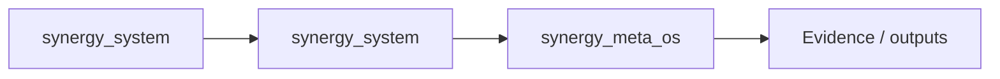
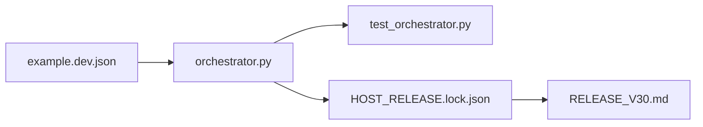

# SYNERGY META-OS

**Runtime orchestration layer for a complete SYNERGY node.**

Architecture root: `Shtenco/synergy_system`  
Target host substrate: `Shtenco/synergy_turbo_linux`  
P2P transport: `Shtenco/synergy_net`

## Role

`synergy_meta_os` is the **running service orchestrator** of an actual node.

Do not confuse it with `synergy_system`:

```text
synergy_system   = architecture, federation, authority map
synergy_meta_os  = runtime supervisor of services on one node
```

## Target node architecture

```text
Signed Node Manifest
        ↓
Host Attestation / Node Identity
        ↓
Capability & Service Graph
        ↓
┌──────────────────────────────────────────────┐
│ SYNERGY Meta-OS                              │
│                                              │
│ SynergyNet daemon                            │
│ Blockchain node role (if authorized)         │
│ MetaPay service role (if authorized)         │
│ Financial OS service role (if authorized)    │
│ NEXUS inference / agents                     │
│ Business Autopilot services                  │
│ Compression/content cache                    │
│ Storage / update / rollback                  │
│ Audit / telemetry / health                   │
└──────────────────┬───────────────────────────┘
                   ↓
          TURBO Linux / compatible host
```

## Non-negotiable authority rule

Meta-OS orchestrates authorities; it does **not merge them**.

A root/supervisor process must not be able to turn:

```text
network privilege → treasury privilege
AI privilege      → payment privilege
blockchain role   → accounting authority
UI role           → ledger mutation
```

Service capabilities should be explicit, revocable and least-privilege.

## Target modules

```text
synergy_meta_os/
  manifest/
  identity/
  attestation/
  capabilities/
  service_graph/
  lifecycle/
  scheduler/
  network/
  blockchain/
  finance/
  agents/
  storage/
  updates/
  rollback/
  observability/
  audit/
```

## Signed node manifest

A node manifest should describe, at minimum:

- node identity/profile;
- software artifact hashes;
- enabled service roles;
- capability grants;
- required ports/endpoints;
- resource limits;
- data directories;
- key references (never raw keys);
- upgrade/rollback policy;
- minimum compatible schema generations;
- expected health checks;
- trust roots / signing policy.

## Node role profiles

Not every node runs everything.

Examples:

```text
EDGE_CLIENT
P2P_RELAY
CONTENT_CACHE
NEXUS_COMPUTE
BLOCKCHAIN_PEER
BLOCKCHAIN_VALIDATOR
METAPAY_GATEWAY
FINANCIAL_SERVICE
BUSINESS_AUTOPILOT
FULL_SYNERGY_NODE
```

High-value roles must require explicit authorization/attestation and must not be inferred from installed software.

## TURBO Linux integration

The preferred long-term host is `turbo_linux`, especially for:

- capability-oriented service isolation;
- bounded IPC;
- protected secrets;
- VM/compatibility domains;
- secure update/rollback;
- device and network service separation.

Meta-OS must also support a compatibility profile on conventional Linux during development.

## SynergyNet integration

SynergyNet is the data-plane transport. Meta-OS controls lifecycle/resource policy around the daemon but does not redefine its routing protocol.

## Financial integration

Meta-OS may launch Financial OS / MetaPay components only on authorized nodes.

It must never interpret “service is running” as “financial action is authorized”.

## Update model

Target update flow:

```text
new signed manifest
→ artifact hash verification
→ compatibility check
→ staged service update
→ health/evidence gates
→ activate
→ automatic rollback on failure
```

Financial and blockchain service updates should bind exact source/build artifacts and require stronger governance than ordinary UI updates.

## Initial milestone

The first meaningful Meta-OS milestone is one reproducible local node that can:

1. verify a signed development manifest;
2. launch isolated SynergyNet + NEXUS + read-only control-plane services;
3. enforce declared capability/resource boundaries;
4. collect deterministic service/audit evidence;
5. update one service and rollback safely;
6. prove that disabled financial/blockchain roles cannot be activated by an unprivileged service.

## Principle

**Meta-OS is the conductor of the node, not the owner of every instrument.**

---

<!-- NEXUS-REPORTS-BENCHMARKS:START -->
## NEXUS — отчёты и бенчмарки

> Канонический реестр: [NEXUS_REPORTS_BENCHMARKS_REGISTRY.md](https://github.com/Shtenco/synergy_gllm_nexus/blob/main/NEXUS_REPORTS_BENCHMARKS_REGISTRY.md)  
> Канонический research runtime: [Shtenco/synergy_gllm_nexus](https://github.com/Shtenco/synergy_gllm_nexus)  
> Активная исследовательская ветка: [unified-v3-generalization-first](https://github.com/Shtenco/synergy_gllm_nexus/tree/unified-v3-generalization-first)  
> Последнее синхронное обновление README: **2026-09-19**

### Ключевые подтверждённые результаты

| Линия / benchmark | Результат | Что проверялось |
|---|---:|---|
| **R7-L D192 / Blind-18** | **3072/3072 = 100%**, 48/48 held-out operators | настоящий few-shot unseen-operator transfer, без Authority и без inference weight updates |
| **R7.2 / Blind-20** | historical **320/320 = 100% harness-assisted**; autonomous exact **254/320 = 79.375%** | final head in old harness used benchmark-side true intent; deployable path uses predicted intent |
| **R7.6 / Blind-23** | **56/58 = 96.55%** | post-freeze semantic/paraphrase transfer |
| **R7.10 / Blind-27** | **150/160 = 93.75%** | fresh 8-domain frozen blind |
| **R7.18 / Blind-31** | **156/200 = 78%** | broad post-freeze OOD |
| **R7.44 / Blind-62** | **3066/3200 = 95.81%** | context/state composite |
| **R7.44.1 / Blind-63** | **2400/2400 = 100%** | context contract |
| **R7.44.2 / Blind-64** | **2400/2400 = 100%** | context contract |
| **R7.44.3 / Blind-65** | **2400/2400 = 100%** | context contract; Dialogue-65 25/25 |
| **Ω-1.5R2 / Blind-4** | strict triple **50.37% / 66.63%** | role/subject/object/graph transfer |
| **Unified v2 UB1** | **904/970 = 93.1959%** | integration benchmark; exposed-development, не pristine blind |
| **Unified v2 UB2** | **2104/2140 = 98.3178%** | regression benchmark; regex baseline повторяет score, paraphrase stress ≈26.17% |
| **v3 P0.1 META-OOS C** | **99.44%** | synthetic OOS внутри одной high-level generator family |
| **HARD-OOS D** | **21.91%**, representation failure **100%** | zero-shot перенос на новый AST/rule-language basis; benchmark уже consumed |
| **v3-MoE P1** | useful Top-K recall **99.62%**, negative transfer **0.48%**, strict routing **98.80%** | learned MoE routing на mixed synthetic META-OOS |
| **NEXUS-MOE-B1** | learned **94.44%**, best single **33.33%**, naive **59.17%**, oracle **95.83%** | frozen one-shot на 7 exact-runnable historical experts; learned negative transfer **1.45%** |
| **FTX1** | **BLIND sealed / unopened** | главный one-shot end-to-end far-transfer benchmark |

### Полный набор канонических отчётов

1. [2026-09-15 — Ω-1.3 local 100K](https://github.com/Shtenco/synergy_gllm_nexus/blob/unified-v3-generalization-first/docs/results/2026-09-15-omega13-local-100k.md)
2. [2026-09-15 — Ω-1.4 local 100K](https://github.com/Shtenco/synergy_gllm_nexus/blob/unified-v3-generalization-first/docs/results/2026-09-15-omega14-local-100k.md)
3. [2026-09-16 — NEXUS cross-generation audit](https://github.com/Shtenco/synergy_gllm_nexus/blob/unified-v3-generalization-first/docs/results/2026-09-16-nexus-cross-generation-audit.md)
4. [2026-09-16 — Full 78-generation evidence ledger](https://github.com/Shtenco/synergy_gllm_nexus/blob/unified-v3-generalization-first/docs/results/2026-09-16-nexus-full-78-ledger.md)
5. [2026-09-16 — Ω-1.5R2 Blind-4 one-shot JSON](https://github.com/Shtenco/synergy_gllm_nexus/blob/unified-v3-generalization-first/docs/results/2026-09-16-omega15r2-blind4-one-shot.json)
6. [2026-09-16 — Ω-1.6 research-agent landscape](https://github.com/Shtenco/synergy_gllm_nexus/blob/unified-v3-generalization-first/docs/results/2026-09-16-omega16-research-agent-landscape.md)
7. [2026-09-16 — Unified NEXUS rebuild v1](https://github.com/Shtenco/synergy_gllm_nexus/blob/unified-v3-generalization-first/docs/results/2026-09-16-unified-nexus-rebuild-v1.md)
8. [2026-09-17 — FTX1 freeze report](https://github.com/Shtenco/synergy_gllm_nexus/blob/unified-v3-generalization-first/docs/results/2026-09-17-nexus-ftx1-freeze-report.md)
9. [2026-09-17 — Unified v3 P0 report](https://github.com/Shtenco/synergy_gllm_nexus/blob/unified-v3-generalization-first/docs/results/2026-09-17-nexus-unified-v3-p0-report.md)
10. [2026-09-17 — Unified v2 RC1 final](https://github.com/Shtenco/synergy_gllm_nexus/blob/unified-v3-generalization-first/docs/results/2026-09-17-unified-v2-rc1-final.md)
11. [2026-09-18 — Unified v3 P0.1 training report](https://github.com/Shtenco/synergy_gllm_nexus/blob/unified-v3-generalization-first/docs/results/2026-09-18-nexus-unified-v3-p01-training-report.md)
12. [2026-09-18 — HARD-OOS D frozen zero-shot report](https://github.com/Shtenco/synergy_gllm_nexus/blob/unified-v3-generalization-first/docs/results/2026-09-18-nexus-v3-hard-oos-d-zero-shot-report.md)
13. [2026-09-18 — v3-MoE P1 training report](https://github.com/Shtenco/synergy_gllm_nexus/blob/unified-v3-generalization-first/docs/results/2026-09-18-nexus-v3-moe-p1-training-report.md)
14. [2026-09-19 — Artifact-Complete audit + NEXUS-MOE-B1](https://github.com/Shtenco/synergy_gllm_nexus/blob/unified-v3-generalization-first/docs/results/2026-09-19-nexus-v3-moe-artifact-complete-b1-report.md)
15. [Unified v2 P0 report](https://github.com/Shtenco/synergy_gllm_nexus/blob/unified-v3-generalization-first/docs/results/UNIFIED_V2_P0_REPORT.md)
16. [Unified v2 P0 / UB1 summary JSON](https://github.com/Shtenco/synergy_gllm_nexus/blob/unified-v3-generalization-first/docs/results/UNIFIED_V2_P0_UB1_SUMMARY.json)

### Frozen benchmark suites и manifests

**CROSSGEN-1**
- [Freeze manifest](https://github.com/Shtenco/synergy_gllm_nexus/blob/unified-v3-generalization-first/benchmarks/crossgen1/CROSSGEN1_FREEZE_MANIFEST.json)
- [Schema](https://github.com/Shtenco/synergy_gllm_nexus/blob/unified-v3-generalization-first/benchmarks/crossgen1/schema.py)

**Ω / Unified frozen**
- [Ω-1.4 Blind-2 freeze](https://github.com/Shtenco/synergy_gllm_nexus/blob/unified-v3-generalization-first/benchmarks/frozen/OMEGA14_BLIND2_FREEZE_MANIFEST.json)
- [Ω-1.5 Blind-3 freeze](https://github.com/Shtenco/synergy_gllm_nexus/blob/unified-v3-generalization-first/benchmarks/frozen/OMEGA15_BLIND3_FREEZE_MANIFEST.json)
- [Ω-1.5R2 preblind final freeze](https://github.com/Shtenco/synergy_gllm_nexus/blob/unified-v3-generalization-first/benchmarks/frozen/OMEGA15R2_PREBLIND_FINAL_FREEZE.json)
- [Ω-1.5R2 Blind-4 freeze](https://github.com/Shtenco/synergy_gllm_nexus/blob/unified-v3-generalization-first/benchmarks/frozen/OMEGA15R2_BLIND4_FREEZE_MANIFEST.json)
- [Unified rebuild v1 freeze](https://github.com/Shtenco/synergy_gllm_nexus/blob/unified-v3-generalization-first/benchmarks/frozen/UNIFIED_REBUILD_V1_FREEZE_MANIFEST.json)
- [Unified integration benchmark freeze](https://github.com/Shtenco/synergy_gllm_nexus/blob/unified-v3-generalization-first/benchmarks/frozen/UNIFIED_REBUILD_V1_INTEGRATION_BENCH_FREEZE.json)
- [Unified preblind checkpoint freeze](https://github.com/Shtenco/synergy_gllm_nexus/blob/unified-v3-generalization-first/benchmarks/frozen/UNIFIED_REBUILD_V1_PREBLIND_CHECKPOINT_FREEZE.json)

**Unified v2 UB2**
- [UB2 README](https://github.com/Shtenco/synergy_gllm_nexus/blob/unified-v3-generalization-first/benchmarks/ub2/README.md)
- [Freeze manifest](https://github.com/Shtenco/synergy_gllm_nexus/blob/unified-v3-generalization-first/benchmarks/ub2/frozen/NEXUS_UB2_FREEZE_MANIFEST.json)
- [Preblind freeze](https://github.com/Shtenco/synergy_gllm_nexus/blob/unified-v3-generalization-first/benchmarks/ub2/frozen/UNIFIED_V2_PREBLIND_FREEZE.json)
- [Source-commit freeze](https://github.com/Shtenco/synergy_gllm_nexus/blob/unified-v3-generalization-first/benchmarks/ub2/frozen/UNIFIED_V2_PREBLIND_SOURCE_COMMIT.json)
- [Blind result](https://github.com/Shtenco/synergy_gllm_nexus/blob/unified-v3-generalization-first/benchmarks/ub2/results/UNIFIED_V2_UB2_BLIND_RESULT.json)
- [Generator](https://github.com/Shtenco/synergy_gllm_nexus/tree/unified-v3-generalization-first/benchmarks/ub2/generator)
- [Scoring](https://github.com/Shtenco/synergy_gllm_nexus/tree/unified-v3-generalization-first/benchmarks/ub2/scoring)
- [Validators](https://github.com/Shtenco/synergy_gllm_nexus/tree/unified-v3-generalization-first/benchmarks/ub2/validators)

**NEXUS-FTX1**
- [FTX1 README](https://github.com/Shtenco/synergy_gllm_nexus/blob/unified-v3-generalization-first/benchmarks/ftx1/README.md)
- [Frozen manifest](https://github.com/Shtenco/synergy_gllm_nexus/blob/unified-v3-generalization-first/benchmarks/ftx1/frozen/NEXUS_FTX1_FREEZE_MANIFEST.json)
- [Public generator](https://github.com/Shtenco/synergy_gllm_nexus/blob/unified-v3-generalization-first/benchmarks/ftx1/public_generator.py)
- [Schema](https://github.com/Shtenco/synergy_gllm_nexus/blob/unified-v3-generalization-first/benchmarks/ftx1/schema.py)
- [Scoring](https://github.com/Shtenco/synergy_gllm_nexus/blob/unified-v3-generalization-first/benchmarks/ftx1/scoring.py)
- [Validators](https://github.com/Shtenco/synergy_gllm_nexus/blob/unified-v3-generalization-first/benchmarks/ftx1/validators.py)
- [Red-team](https://github.com/Shtenco/synergy_gllm_nexus/blob/unified-v3-generalization-first/benchmarks/ftx1/redteam.py)
- **BLIND остаётся sealed/unopened.**

### Benchmark runners

- [Belief](https://github.com/Shtenco/synergy_gllm_nexus/blob/unified-v3-generalization-first/benchmarks/run_belief_benchmark.py)
- [General](https://github.com/Shtenco/synergy_gllm_nexus/blob/unified-v3-generalization-first/benchmarks/run_benchmark.py)
- [Compiler](https://github.com/Shtenco/synergy_gllm_nexus/blob/unified-v3-generalization-first/benchmarks/run_compiler_benchmark.py)
- [Consolidation](https://github.com/Shtenco/synergy_gllm_nexus/blob/unified-v3-generalization-first/benchmarks/run_consolidation_benchmark.py)
- [Continual](https://github.com/Shtenco/synergy_gllm_nexus/blob/unified-v3-generalization-first/benchmarks/run_continual_benchmark.py)
- [Forgetting](https://github.com/Shtenco/synergy_gllm_nexus/blob/unified-v3-generalization-first/benchmarks/run_forgetting_benchmark.py)
- [Graph Cortex](https://github.com/Shtenco/synergy_gllm_nexus/blob/unified-v3-generalization-first/benchmarks/run_graph_cortex_benchmark.py)
- [Research](https://github.com/Shtenco/synergy_gllm_nexus/blob/unified-v3-generalization-first/benchmarks/run_research_benchmark.py)
- [Temporal](https://github.com/Shtenco/synergy_gllm_nexus/blob/unified-v3-generalization-first/benchmarks/run_temporal_benchmark.py)
- [Unified v2 preblind UB1](https://github.com/Shtenco/synergy_gllm_nexus/blob/unified-v3-generalization-first/benchmarks/run_unified_v2_preblind_ub1.py)

### v3 артефакты

**P0.1 META-OOS**
- [Manifest](https://github.com/Shtenco/synergy_gllm_nexus/blob/unified-v3-generalization-first/artifacts/v3_meta/p01_first_hard/manifest.json)
- [Metrics](https://github.com/Shtenco/synergy_gllm_nexus/blob/unified-v3-generalization-first/artifacts/v3_meta/p01_first_hard/metrics.json)
- [Ranker](https://github.com/Shtenco/synergy_gllm_nexus/blob/unified-v3-generalization-first/artifacts/v3_meta/p01_first_hard/ranker.pt)

**HARD-OOS D**
- [Manifest](https://github.com/Shtenco/synergy_gllm_nexus/blob/unified-v3-generalization-first/artifacts/v3_hard_oos_d/manifest.json)
- [Corpus summary](https://github.com/Shtenco/synergy_gllm_nexus/blob/unified-v3-generalization-first/artifacts/v3_hard_oos_d/corpus_summary.json)
- [Topology inventory](https://github.com/Shtenco/synergy_gllm_nexus/blob/unified-v3-generalization-first/artifacts/v3_hard_oos_d/topology_inventory.json)
- [Zero-shot metrics](https://github.com/Shtenco/synergy_gllm_nexus/blob/unified-v3-generalization-first/artifacts/v3_hard_oos_d/zero_shot_metrics.json)
- [Baselines](https://github.com/Shtenco/synergy_gllm_nexus/blob/unified-v3-generalization-first/artifacts/v3_hard_oos_d/baseline_metrics.json)
- [Consumed marker](https://github.com/Shtenco/synergy_gllm_nexus/blob/unified-v3-generalization-first/artifacts/v3_hard_oos_d/consumed.json)

**v3-MoE P1**
- [Manifest](https://github.com/Shtenco/synergy_gllm_nexus/blob/unified-v3-generalization-first/artifacts/v3_moe/p1/manifest.json)
- [Metrics](https://github.com/Shtenco/synergy_gllm_nexus/blob/unified-v3-generalization-first/artifacts/v3_moe/p1/metrics.json)
- [Router](https://github.com/Shtenco/synergy_gllm_nexus/blob/unified-v3-generalization-first/artifacts/v3_moe/p1/router.pt)
- [Novelty](https://github.com/Shtenco/synergy_gllm_nexus/blob/unified-v3-generalization-first/artifacts/v3_moe/p1/novelty.pt)
- [Calibrator](https://github.com/Shtenco/synergy_gllm_nexus/blob/unified-v3-generalization-first/artifacts/v3_moe/p1/calibrator.pt)

### Научная политика

- Few-shot unseen-operator induction и zero-shot перенос на новый язык правил — разные уровни transfer.
- UB2 хранится как regression benchmark, но его 98.3178% не считается доказательством общего интеллекта.
- HARD-OOS D уже **consumed** и не может повторно считаться clean OOS после D-informed обучения.
- FTX1 BLIND остаётся закрытым до one-shot protocol.
- v3-MoE P1 пока доказывает качество **routing**, а не окончательный end-to-end прирост answer accuracy.

<!-- NEXUS-REPORTS-BENCHMARKS:END -->


<!-- SYNERGY-FEDERATION-PASSPORT:START -->
---

##  SYNERGY federation passport

**Домен:**  Runtime orchestration  
**Архитектурный родитель:** [`synergy_system`](https://github.com/Shtenco/synergy_system)  
**Архитектурный корень:** [`synergy_system`](https://github.com/Shtenco/synergy_system)



Архитектурная принадлежность не заменяет доказанную интеграцию. Runtime-связь должна подтверждаться контрактами, manifests, deployment-конфигурацией или тестами.

### Федерационный принцип

Каждый репозиторий отвечает только за свой тип истины и не должен незаметно присваивать полномочия соседнего домена.

### Навигация

- [ Атлас 75 репозиториев](https://github.com/Shtenco/synergy_system/blob/main/docs/SYNERGY_REPOSITORY_ATLAS.md)
- [ Registry](https://github.com/Shtenco/synergy_system/blob/main/registry/SYNERGY_REPOSITORIES.json)
- [ Architecture root](https://github.com/Shtenco/synergy_system)

### Evidence rule

Любое сильное утверждение должно указывать на воспроизводимый тест, benchmark, ledger/evidence artifact или формально проверяемый контракт.

<!-- SYNERGY-FEDERATION-PASSPORT:END -->

---

#  Фактический bootstrap `main`

На текущем `main` уже есть минимальный executable bootstrap:

```text
manifest/example.dev.json
runtime/orchestrator.py
tests/test_orchestrator.py
releases/v30/HOST_RELEASE.lock.json
releases/v30/RELEASE_V30.md
```

Это позволяет точнее определить текущую зрелость Meta-OS: не пустой концепт, но ещё не полный service mesh всей федерации.



### Следующий executable gate

1. signed manifest verification;
2. explicit capabilities;
3. launch at least SynergyNet + NEXUS read-only services;
4. negative test: disabled finance/blockchain role cannot activate;
5. update + rollback evidence;
6. deterministic audit trail.
